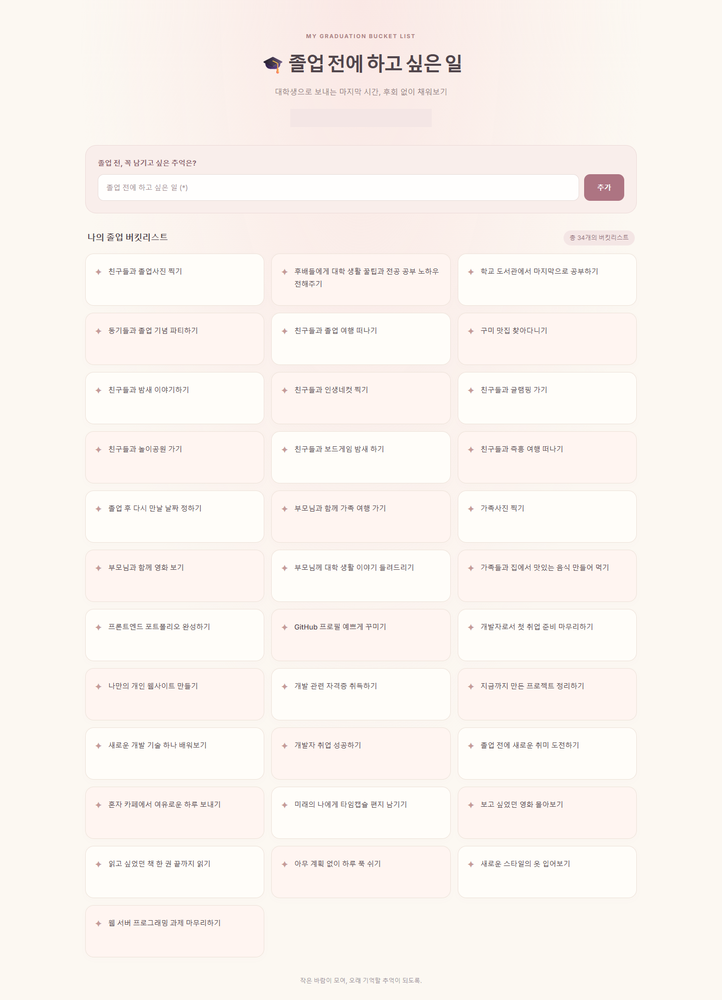
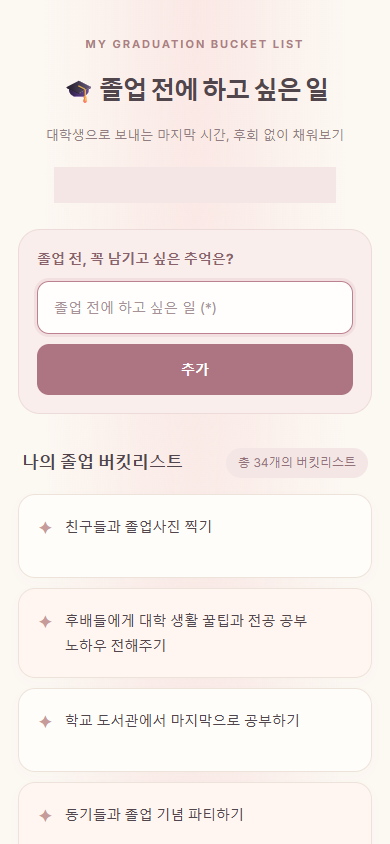

<div align="center">


# 2026 웹서버프로그래밍 중간고사

### 졸업 전에 하고 싶은 일

대학생으로 보내는 마지막 시간, 후회 없이 채워보기

**20230625 신혜원**


<br /><br />

[프로젝트 소개](#-프로젝트-소개) · [실행 화면](#-실행-화면) · [사용 기술](#-사용-기술) · [실행 방법](#-실행-방법)

</div>

---

## 🌷 프로젝트 소개

웹서버프로그래밍 중간고사 예제의 **빈칸 20개**를 완성하고, 기존의 ‘시험 끝나고 하고 싶은 일’을 **‘졸업 전에 하고 싶은 일’**로 변경한 실습 과제입니다.

React Router, Zustand, TanStack Query, Supabase의 핵심 구현을 유지하면서 졸업을 앞둔 대학생의 버킷리스트라는 주제에 맞게 화면과 예제 데이터를 변경했습니다.

### 주요 기능

| 기능 | 구현 내용 |
| --- | --- |
| 🔐 인증 | 기존 세션 확인 및 실습 계정 자동 로그인 |
| 📋 목록 조회 | Supabase `plans` 조회 및 실제 항목 수 표시 |
| ✍️ 항목 추가 | 입력 폼 제출, 필수 입력 검증, 데이터 저장 |
| 🔄 목록 갱신 | 추가 성공 시 캐시 무효화 및 입력창 초기화 |
| 💬 상태 안내 | 로딩·오류·빈 목록 표시, 빈 목록에서도 항목 추가 |

## 🖼️ 실행 화면

<table>
  <tr>
    <th width="73%">Desktop · 3열 카드 목록</th>
    <th width="27%">Mobile · 1열 레이아웃</th>
  </tr>
  <tr>
    <td valign="top"><a href="docs/images/desktop.png"></a></td>
    <td valign="top"><a href="docs/images/mobile.png"></a></td>
  </tr>
</table>

> 실제 로컬 실행 화면입니다. 기본 예제 33개에 보고서의 추가 테스트 항목 1개가 더해져 **총 34개**로 표시됩니다. 로그인 정보는 가렸으며, 이미지를 누르면 원본을 확인할 수 있습니다.

### 디자인 포인트

| 🌸 따뜻한 색감 | 🗂️ 읽기 편한 카드 | 📱 반응형 화면 |
| :--- | :--- | :--- |
| 아이보리와 연핑크, 둥근 모서리 | 긴 문장 줄바꿈과 목록 상단 입력 폼 | PC 3열 · 태블릿 2열 · 모바일 1열 |

- **졸업 테마** — 제목·부제목·탭 제목을 변경하고 졸업 모자 파비콘을 적용했습니다.
- **반응형 그리드** — 기본 3열, 900px 이하 2열, 600px 이하 1열로 표시합니다.
- **빈 목록 개선** — 안내 문구와 입력 폼을 함께 표시하여 첫 항목도 등록할 수 있습니다.
- **실제 데이터 연동** — 화면에 예제를 하드코딩하지 않고 Supabase에서 조회합니다.

예제는 대학 생활, 친구들과 추억 만들기, 가족과 함께, 개발과 취업, 나를 위한 시간의 **33개 항목**으로 구성했습니다. 이 구분은 데이터 주제를 설명하기 위한 것으로 별도의 카테고리 기능은 구현하지 않았습니다.

## 🛠️ 사용 기술

| 기술 | 사용 목적 |
| --- | --- |
| **React · TypeScript** | 화면 구성 및 타입 검사 |
| **React Router** | 레이아웃·인덱스 라우트 구성, `clientLoader` |
| **Zustand** | 사용자·세션·인증 상태 관리 |
| **TanStack Query** | 목록 조회, 항목 추가, 캐시 무효화 |
| **Supabase** | 사용자 인증 및 PostgreSQL 데이터 저장 |
| **Tailwind CSS · CSS** | 기본 스타일 및 반응형 카드 디자인 |

## 📁 프로젝트 구성

```text
app/
├── routes.ts              # 레이아웃 및 인덱스 라우트
├── root.tsx               # QueryClientProvider 및 문서 구조
├── app.css                # 전체 화면 스타일
├── lib/
│   ├── auth-store.ts       # 인증 상태 및 로그인
│   └── supabase.ts         # Supabase 클라이언트
└── routes/
    ├── header.tsx         # 세션 확인, 제목 및 공통 레이아웃
    └── list.tsx           # 목록 조회·추가 및 상태별 화면
public/
└── favicon.svg            # 졸업 모자 파비콘
docs/images/               # PC·모바일 실행 화면
```

## 🚀 실행 방법

### 1. 의존성 설치

```bash
pnpm install
```

### 2. 환경 변수 설정

프로젝트 루트의 `.env.local`에 본인 Supabase 프로젝트의 환경 변수를 설정합니다.

```dotenv
VITE_SUPABASE_URL=본인의_Supabase_프로젝트_URL
VITE_SUPABASE_PUBLISHABLE_KEY=본인의_Supabase_publishable_key
```

Supabase에는 `plans` 테이블과 인증 계정이 필요합니다. 보고서의 DDL을 기준으로 `id`, `created_at`, `user_id`, `title` 및 사용자별 접근을 제한하는 RLS 정책을 설정합니다. `user_id`의 기본값은 `auth.uid()`입니다. 환경 변수만 설정해도 테이블과 데이터가 자동 생성되는 구조는 아닙니다.

### 3. 개발 서버 실행

```bash
pnpm dev
```

터미널에 표시되는 로컬 주소로 접속합니다. 기본 주소는 `http://localhost:5173`입니다. 기존 시험 코드에 따라 세션이 없으면 설정된 실습 계정으로 자동 로그인합니다.

<details>
<summary><strong>타입 검사 · 빌드 · Windows 실행 안내</strong></summary>

```bash
pnpm typecheck
pnpm build
```

Windows PowerShell에서 실행 정책으로 `pnpm`이 차단되는 경우 `pnpm.cmd`로 실행할 수 있습니다.

</details>

## 🔎 핵심 구현

시험의 **20개 빈칸에 해당하는 코드**를 유지했습니다. 서비스 주제가 바뀌어도 쿼리 키는 기존 `escape-to-do`를 사용합니다.

| 단계 | 처리 흐름 |
| --- | --- |
| **인증** | `clientLoader` → 세션 확인 및 로그인 → Zustand에 사용자 상태 저장 |
| **조회** | `useQuery` → `plans` 조회 → `myList.map`으로 카드 출력 |
| **추가** | form 제출 → `useMutation` → Supabase INSERT |
| **갱신** | `invalidateQueries` → 목록 재조회 · `setTitle("")` → 입력창 초기화 |

소스코드별 풀이, 20개 정답 정리표, 데이터베이스 DDL 및 케이스별 실행 화면은 별도 제출 보고서에 정리했습니다.

---

<div align="center">
  <sub>🎓 작은 바람이 모여, 오래 기억할 추억이 되도록.</sub>
</div>
